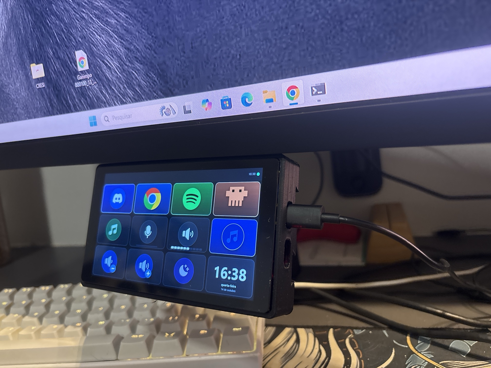
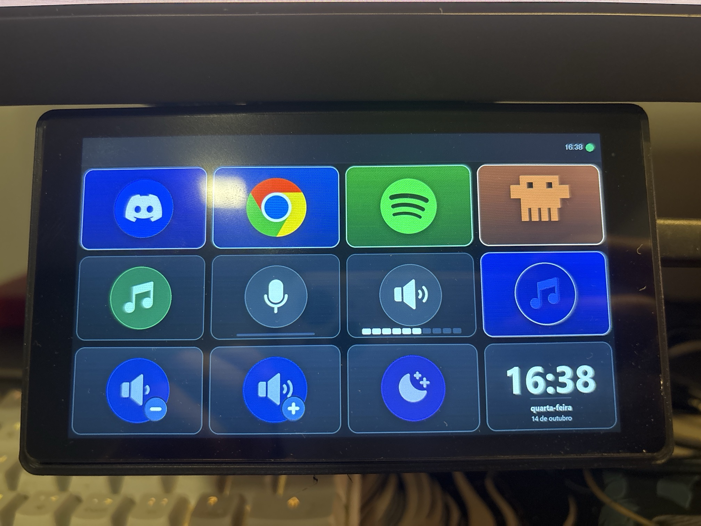
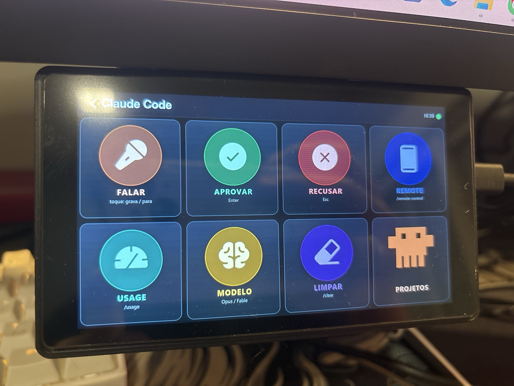
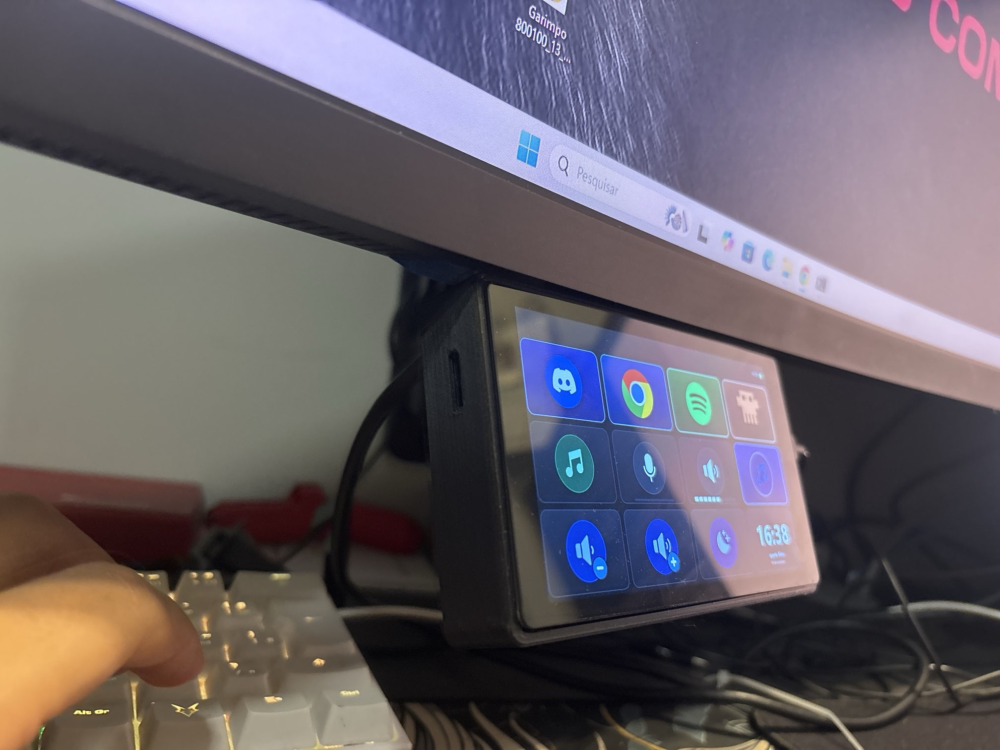
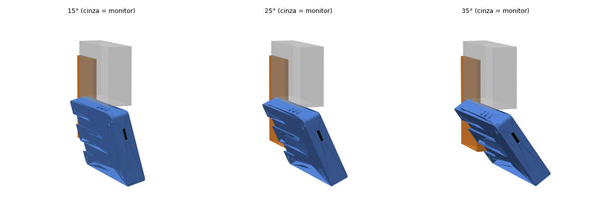

<div align="center">

# Telinha Deck

**A 5" touch control deck that lives under your monitor and adapts to whatever you're doing.**

A DIY Stream Deck built on an ESP32-P4: app shortcuts, media, Spotify, OBS, Discord,
calendar and a dedicated Claude Code page. Every pixel is rendered on the PC and
streamed over USB.




</div>

> 🚧 **Work in progress.** It runs on my desk every day, but it is mid-way through a
> rewrite into an installable app (see [Roadmap](#roadmap)). Expect rough edges.

---

## What it is

Telinha Deck is a 1280×720 touchscreen clipped under the monitor. It shows buttons,
what's playing, volume, the next meeting and Claude Code controls. One tap and the
PC does the thing.

The interesting part is the architecture: **the board is dumb.** All artwork
(icons, album covers, live cards) is composed on the PC with Pillow and sent to the
board as JPEG over serial. Changing an icon, a color or what a button does is a
profile edit — the firmware never needs to be reflashed.

## Features

| | |
|---|---|
| 🎵 **Media & Spotify** | live album art, progress, like, shuffle, repeat (Spotify Web API with PKCE) |
| 🔊 **Audio** | mic mute (Windows + Discord), volume with a level meter, multi-output soundboard |
| 🤖 **Claude Code** | dedicated page: voice, approve, reject, model switch. Only types when the right terminal is in focus |
| 🪟 **Per-window profiles** | the deck switches pages on its own when Discord, the Claude terminal or OBS takes focus |
| 🎬 **OBS** | go live, record, pause, replay; scenes read from OBS and lit by real state |
| 📅 **Idle screen** | big clock, weather (Open-Meteo) and next meeting; kicks in when the PC goes idle |
| 📁 **Projects** | one tap opens a terminal in the project folder |
| ✏️ **Visual editor** | desktop window with a virtual board: drag and drop, undo, history, test |

<table>
  <tr>
    <td width="50%"></td>
    <td width="50%"></td>
  </tr>
  <tr>
    <td align="center"><b>Home</b> — apps opening on the second monitor, media, mic, volume meter, idle mode and clock</td>
    <td align="center"><b>Claude Code</b> — voice, approve, reject, remote, usage, model, clear and projects</td>
  </tr>
</table>

## How it works

```
┌──────────────────────── PC (Windows) ────────────────────────┐
│                                                              │
│  MODULES        audio · media · spotify · calendar · weather │
│                 obs · soundboard · projects · windows · …    │
│        │                                                     │
│        ▼                                                     │
│  CORE           compositor (Pillow → JPEG) · router          │
│                 state bus · module host · profile store      │
│        │                                                     │
│        ▼                                                     │
│  LINK           serial @ 921600 baud, art queue, retries     │
│                                                              │
│  WINDOW         React editor (pywebview + WebView2)          │
└────────┬─────────────────────────────────────────────────────┘
         │ USB-C  (JSON + chunked JPEG)
         ▼
┌──────────── ESP32-P4 · Waveshare 5" touch ────────────┐
│  blits the JPEGs, draws pressed states, reports taps  │
└───────────────────────────────────────────────────────┘
```

A few rules keep the screen smooth:

- **Live cards have a fixed id and a version.** The board redraws only the card that
  changed, with no flicker.
- **Nothing slow runs in the serial loop.** Actions run in a worker pool and artwork
  comes from the compositor with a deadline. A stuck module becomes a warning in the
  status bar, never a frozen screen.
- **Never type blind.** Every typing action requires the expected app in the foreground.

More in [`docs/DEVELOPMENT.md`](docs/DEVELOPMENT.md).

## Hardware

- **Board:** [Waveshare ESP32-P4-WIFI6-Touch-LCD-5](https://www.waveshare.com/esp32-p4-wifi6-touch-lcd-5.htm) (rev v3.2)
- **Enclosure & mount:** 3D printed, modeled in Python (`caixa/`), with a 15°, 25° or 35°
  bracket that hangs under the monitor

<p align="center">
  
  
</p>

Print and assembly notes (Portuguese) in [`caixa/README.md`](caixa/README.md).

## Repository layout

| Folder | Contents |
|---|---|
| [`app/`](app/README.md) | the new app: core, module SDK, modules, app packs, React editor and tests |
| `firmware/telinha_p4/` | board firmware (Arduino + LovyanGFX) and `build.ps1` |
| `caixa/` | enclosure and bracket in Python → STL / STEP |
| `agent/` | legacy agent, kept as a fallback until the switch to the new app |
| `arquivo/` | previous generations (JOQUEI and RÉDEA), reference only |
| `PLANO.md` | the full plan for the installable app, stage by stage (Portuguese) |
| `IDEIAS.md` | what's done and what's next (Portuguese) |

## Running

```powershell
cd app
pip install -r ..\agent\requirements.txt
python -m telinha bandeja        # tray icon; starts and supervises the core
python -m telinha janela         # opens the editor with the virtual board
python -m pytest testes -q       # whole core against a fake board
```

Working on the editor? Run `npm install && npm run build` inside `app/editor/`.
User data (profile, tokens, cache and log) lives in `%APPDATA%\TELINHA\`, outside the repo.

**Firmware:** `.\firmware\build.ps1`. The FQBN needs `ChipVariant=postv3` and
LovyanGFX carries a patch in `Bus_DSI.cpp` — see [`docs/DEVELOPMENT.md`](docs/DEVELOPMENT.md).

## Roadmap

- [x] Stage 0 — packaging and window proofs
- [x] Stage 1 — new core + 11 modules running on the board *(final tap check pending)*
- [ ] Stage 2 — app window with status and module management
- [ ] Stage 3 — full editor (drag and drop, folders, shortcut recording)
- [ ] Stage 4 — multiple accounts (Spotify, Google)
- [ ] Stage 5 — per-app volume, Claude Code hooks with approve/deny, firmware with partial redraws
- [ ] Stage 6 — installer and first-run wizard
- [ ] Stage 7 — downloads, signed auto-update and a pack catalog

Track progress on the [project board](https://github.com/users/gabrielDallape/projects/2).
